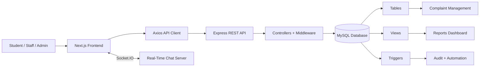
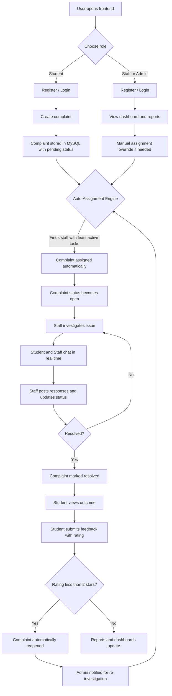

# Campus Complaint Management System

A full-stack campus complaint management system built as a DBMS project. It helps students raise complaints, allows staff and admins to track and resolve them, and provides reporting views for operational monitoring — with smart automation workflows built right in.

The repository contains:

- `frontend/`: Next.js 16 + React 19 client
- `backend/`: Express 5 + MySQL API
- `backend/database/schema.sql`: database schema, seed data, views, and triggers

## Overview

This system centralizes complaint handling for a college or campus environment:

- Students can register, log in, file complaints, track complaint status, and submit feedback after resolution.
- Staff can log in, view assigned complaints, post responses, and update complaint status.
- Admins can assign complaints to staff and access reporting dashboards.
- Reports summarize complaint status, open complaints, staff performance, and average resolution time.
- Complaints are **automatically assigned** to the least-loaded available staff member.
- Negative feedback (< 2 stars) **automatically reopens** the complaint for re-investigation.
- Students and assigned staff can **chat in real time** within a complaint thread.

## Features

### Student Features

- Student registration and login
- Submit a new complaint with category and priority
- View personal complaint history
- Open complaint detail pages to track status and responses
- Submit feedback with rating after a complaint is resolved
- Real-time chat with the assigned staff member inside a complaint thread

### Staff / Admin Features

- Staff/admin registration and login
- View complaint dashboard
- View complaint details and response history
- Add responses to complaints
- Update complaint status
- Admin-only complaint assignment to staff (manual override)
- Access reports dashboard
- Real-time chat with the student who raised the complaint

### Automated Workflow Features

- **Smart Auto-Assignment**: When a complaint is submitted, the system automatically assigns it to the available staff member with the least number of active tasks — no manual admin intervention needed for routine cases.
- **Feedback-Driven Reopening**: If a student submits a rating of less than 2 stars, the complaint is automatically reopened and flagged for re-investigation by the admin.
- **Real-Time Chat**: Students and their assigned staff can communicate directly within the complaint thread using a live chat interface, reducing resolution delays.

### DBMS Features Used

- Relational schema with foreign keys
- Seeded master data for complaint categories
- SQL views for dashboards and reporting
- SQL triggers for lifecycle automation and audit logging
- Aggregation queries for analytics

## Tech Stack

| Layer | Technology |
| --- | --- |
| Frontend | Next.js 16, React 19, TypeScript, Tailwind CSS 4, Axios |
| Backend | Node.js, Express 5, mysql2, bcryptjs, jsonwebtoken, dotenv |
| Database | MySQL |
| Real-Time | Socket.IO (planned) |
| Package Manager | pnpm |
| Dev Database Option | Docker Compose |

## Project Structure

```text
Campus-Complaint-Management-System/
|-- backend/
|   |-- database/
|   |   `-- schema.sql
|   |-- src/
|   |   |-- config/
|   |   |-- controllers/
|   |   |-- middleware/
|   |   |-- routes/
|   |   |-- utils/
|   |   |-- app.js
|   |   `-- server.js
|   |-- docker-compose.yml
|   `-- package.json
|-- frontend/
|   |-- app/
|   |-- components/
|   |-- context/
|   |-- lib/
|   `-- package.json
`-- README.md
```

## System Architecture



## Project Workflow



## Automated Workflows — Detailed Design

### 1. Smart Auto-Assignment (Least-Task Routing)

When a new complaint is submitted:

1. The system queries all active staff members and counts their current open/in-progress task load.
2. The staff member with the **fewest active complaints** is selected automatically.
3. If there is a tie, the system picks the staff member who was assigned least recently (round-robin fallback).
4. The complaint is assigned to that staff member and its status changes from `pending` to `open`.
5. Admins retain the ability to **manually override** the assignment at any time.

> **Planned implementation approach:** A trigger or service function fires after a new complaint row is inserted, queries the `vw_staff_workload` view (already in schema), and writes the selected `staff_id` back to the complaint.

---

### 2. Feedback Loop — Auto-Reopen on Negative Review

After a complaint is resolved, the student submits a feedback rating (1–5 stars):

1. If the rating submitted is **less than 2 stars**, the system detects the low score.
2. The complaint status is automatically changed from `resolved` to `reopened`.
3. An audit entry is created noting the reason: *"Low feedback score — reopened for review"*.
4. The admin is notified (via dashboard flag) that this complaint needs attention.
5. The complaint re-enters the assignment workflow.

> **Planned implementation approach:** An `AFTER INSERT` trigger on the `feedback` table checks the rating value. If `rating < 2`, it updates the complaint status to `reopened` and inserts into `complaint_audit`.

---

### 3. Real-Time Chat (Student and Assigned Staff)

Within each complaint thread, the student who raised it and the staff member assigned to it can exchange messages live:

1. When a student or staff opens the complaint detail page, a **Socket.IO** connection is established for that complaint's chat room (`room_id = complaint_id`).
2. Messages sent by either party are broadcast only to participants of that specific complaint room.
3. Chat history is persisted in a `chat_message` table (planned) for reference.
4. Messages are timestamped and labelled with sender role (Student / Staff).
5. Unread message counts are shown on the complaint dashboard.

> **Planned implementation approach:** A Socket.IO server is added alongside the Express backend. Frontend uses the Socket.IO client inside the complaint detail page component.

---

## Database Design

### Core Tables

- `category`
- `student`
- `staff`
- `complaint`
- `response`
- `feedback`
- `complaint_audit`

### Planned Additional Tables

- `chat_message` — stores real-time chat messages per complaint

### Database Views

- `vw_open_complaints`
- `vw_student_complaint_history`
- `vw_staff_workload` ← used by the auto-assignment engine
- `vw_category_stats`

### Database Triggers

- `trg_set_resolved_date` — sets `date_resolved` when a complaint becomes resolved
- `trg_feedback_only_on_resolved` — blocks feedback unless the complaint is resolved
- `trg_audit_status_change` — logs status changes into `complaint_audit`
- `trg_auto_open_on_assign` — changes `pending` to `open` when staff is assigned

### Planned Additional Triggers

- `trg_auto_assign_on_complaint` — fires after complaint insert; assigns the least-loaded available staff automatically
- `trg_reopen_on_low_feedback` — fires after feedback insert; reopens complaint if rating is less than 2

## API Overview

Base URL:

```text
http://localhost:4000/api
```

### Health

- `GET /health`
- `GET /api/health`

### Students

- `POST /api/students/register`
- `POST /api/students/login`
- `GET /api/students/:id`
- `PATCH /api/students/:id`
- `GET /api/students/:id/complaints`

### Staff

- `GET /api/staff`
- `POST /api/staff/register`
- `POST /api/staff/login`
- `POST /api/staff`
- `GET /api/staff/:id`
- `PATCH /api/staff/:id`
- `DELETE /api/staff/:id`
- `GET /api/staff/:id/complaints`

### Categories

- `GET /api/categories`
- `GET /api/categories/:id`
- `POST /api/categories`
- `PATCH /api/categories/:id`
- `DELETE /api/categories/:id`

### Complaints

- `GET /api/complaints`
- `POST /api/complaints`
- `GET /api/complaints/:id`
- `PATCH /api/complaints/:id`
- `DELETE /api/complaints/:id`
- `PATCH /api/complaints/:id/assign`

### Responses

- `POST /api/responses`
- `GET /api/responses/complaint/:complaintId`

### Feedback

- `POST /api/feedback`
- `GET /api/feedback/complaint/:complaintId`

### Reports

- `GET /api/reports/complaints-by-status`
- `GET /api/reports/complaints-by-category`
- `GET /api/reports/complaints-by-department`
- `GET /api/reports/staff-performance`
- `GET /api/reports/average-resolution-time`
- `GET /api/reports/open-complaints-dashboard`

### Chat (Planned)

- `GET /api/chat/:complaintId/messages` — fetch chat history for a complaint
- `POST /api/chat/:complaintId/messages` — post a message (fallback REST; primary via Socket.IO)

## Local Setup

### Prerequisites

- Node.js 20+
- pnpm
- MySQL 8+ or Docker Desktop

### 1. Start the Database

You can either use a local MySQL server or the included Docker Compose file.

#### Option A: Docker

From `backend/`:

```bash
docker compose up -d
```

> The Docker container exposes MySQL on host port `3307`. If you use Docker, set `DB_PORT=3307` in your `.env`.

### 2. Create Backend Environment Variables

Create `backend/.env`:

```env
NODE_ENV=development
PORT=4000
DB_HOST=127.0.0.1
DB_PORT=3307
DB_USER=root
DB_PASSWORD=example
DB_NAME=campus_complaints
JWT_SECRET=replace_this_with_a_secure_secret
JWT_EXPIRES_IN=2h
```

If using a local MySQL installation instead of Docker, change `DB_PORT` to `3306`.

### 3. Import the Database Schema

```bash
mysql -h 127.0.0.1 -P 3307 -u root -p < backend/database/schema.sql
```

This will:

- Create the `campus_complaints` database
- Create all tables
- Insert default categories
- Create views and triggers

### 4. Install and Run the Backend

```bash
cd backend
pnpm install
pnpm dev
```

Backend runs on `http://localhost:4000`

### 5. Create Frontend Environment Variables

Create `frontend/.env.local`:

```env
NEXT_PUBLIC_API_URL=http://localhost:4000/api
```

### 6. Install and Run the Frontend

```bash
cd frontend
pnpm install
pnpm dev
```

Frontend runs on `http://localhost:3000`

## Default User Flow

1. Register as a student, staff, or admin.
2. Log in from the frontend.
3. Students submit complaints with category and priority.
4. System **auto-assigns** the complaint to the least-loaded available staff member.
5. Staff updates status, adds responses, and chats with the student in real time.
6. Students track progress from the dashboard and chat directly with assigned staff.
7. After resolution, students submit feedback with a star rating.
8. If rating is **less than 2 stars**, the complaint is **automatically reopened** for re-investigation.
9. Staff/admin users review reports and open complaint dashboards.

## Important Implementation Notes

- JWT tokens are issued for both student and staff/admin login flows.
- The frontend stores the token and user object in `localStorage`.
- The Axios client automatically sends the stored token as a Bearer token.
- JWT middleware is applied to student profile and student complaint-history routes. Most staff/admin and management routes are not yet fully protected — treat this as a development/academic project rather than a production-secure deployment.
- The current response API requires `staff_id`, so complaint replies are effectively staff/admin-driven in the backend implementation.

## Planned / Upcoming Features

- Smart auto-assignment based on staff task count *(designed, pending implementation)*
- Auto-reopen on negative feedback rating less than 2 stars *(designed, pending implementation)*
- Real-time chat between student and assigned staff via Socket.IO *(designed, pending implementation)*
- Add role-based route protection for all admin and staff operations
- Add dedicated admin UI for category and staff management
- Add validation and form-level error feedback everywhere
- Add automated tests for controllers and frontend flows
- Add email or in-app notifications for complaint updates
- Add charts to the reports dashboard

## Screens Included in the Frontend

- Landing page
- Login page
- Registration page
- Dashboard page
- New complaint page
- Complaint detail page (with planned chat thread)
- Reports page
